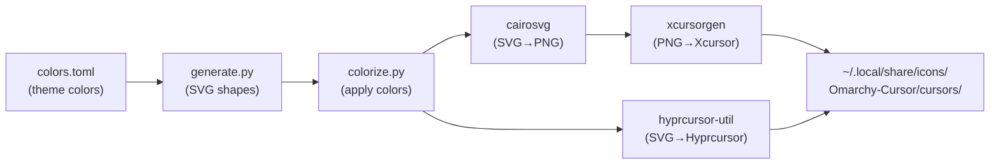

# Omarchy Cursor Theme

Build an original cursor set for Omarchy with custom SVG artwork, animations, theme-aware colorization, and publish to GitHub as `omarchy-cursor`.

## User Review Required

> [!IMPORTANT]
> **Original SVG artwork**: Cursor shapes will be generated programmatically via Python (`svgwrite`), not hand-drawn in a design tool. This gives us precise geometric shapes with clean lines, but they'll have a modern/minimalist geometric aesthetic rather than hand-crafted artistic curves. If you want hand-illustrated cursors, that's a different workflow involving Figma/Inkscape.

> [!IMPORTANT]
> **Animation scope**: Animated cursors (wait spinner, progress indicator, hover glow) require 30-54 SVG frames each. The build script generates these frames procedurally. True "transition" animations between cursor states (e.g. arrow morphing into hand) are not supported by the X11/Hyprcursor format, as the compositor switches cursors instantly. We can do animated glow/pulse effects on static cursors though.

## Open Questions

> [!NOTE]
> **Cursor size canvas**: Bibata uses 256x256 SVG canvas with hotspots mapped accordingly. Sticking with this convention for compatibility. Final rendered sizes: 24, 32, 48, 64, 96px.

## Design Direction

### Visual Style
- **Geometric minimalist** with subtle organic curves
- Clean outlines with filled interiors (two-color system like Bibata: base fill + outline stroke)
- Slightly rounded terminals for a friendly feel
- Subtle drop shadow or glow effects on animated cursors

### Cursor Shapes (55 total, matching Bibata coverage)

| Category | Cursors |
|----------|---------|
| **Pointers** | `left_ptr` (default arrow), `right_ptr`, `center_ptr` |
| **Hands** | `hand1` (grab), `hand2` (pointer/link), `grabbing` |
| **Text** | `xterm` (I-beam), `vertical-text` |
| **Resize** | All 8 directional edges + corners, `move`, `sb_h/v_double_arrow` |
| **Loading** | `wait` (54 frames), `left_ptr_watch` (54 frames) |
| **Actions** | `crosshair`, `pencil`, `zoom-in`, `zoom-out`, `plus`/`cell` |
| **DnD** | `copy`, `link`, `dnd-ask`, `dnd-copy`, `dnd-link`, `dnd_no_drop` |
| **Misc** | `circle`, `crossed_circle`, `question_arrow`, `X_cursor`, `context-menu` |
| **Navigation** | `sb_up/down/left/right_arrow`, tees, angles |

### Animation Design

1. **Wait spinner** (`wait`): Orbital dots rotating around center, with trailing glow fade. 54 frames at 40ms = 2.16s full rotation.
2. **Progress indicator** (`left_ptr_watch`): Arrow cursor with pulsing ring at bottom-right. 54 frames.
3. **Static cursors with accent glow**: The base color gets a subtle outer glow (achieved via SVG filter or stroke layering), giving a soft neon halo effect that looks especially good on dark themes.

## Proposed Changes

### Project Structure

```
~/Projects/omarchy-cursor/
├── README.md
├── LICENSE                    # MIT
├── .gitignore
├── pyproject.toml             # Python project config
├── build.py                   # Main build script
├── install.sh                 # Quick install script
├── src/
│   └── omarchy_cursor/
│       ├── __init__.py
│       ├── generate.py        # SVG generation (all cursor shapes)
│       ├── animate.py         # Animation frame generation
│       ├── colorize.py        # Theme color extraction & application
│       ├── render.py          # SVG→PNG→Xcursor pipeline
│       ├── hyprcursor.py      # Hyprcursor format output
│       └── shapes/            # Individual shape definitions
│           ├── __init__.py
│           ├── pointers.py    # Arrow cursors
│           ├── hands.py       # Hand/grab cursors
│           ├── text.py        # Text selection cursors
│           ├── resize.py      # Resize/move cursors
│           ├── actions.py     # Crosshair, pencil, zoom, etc.
│           ├── dnd.py         # Drag-and-drop cursors
│           ├── loading.py     # Wait/progress animations
│           └── misc.py        # X_cursor, question, etc.
├── config/
│   └── cursors.toml           # Hotspot definitions, symlink mappings
└── preview/                   # Generated preview images for README
```

---

### [NEW] `pyproject.toml`

Python project with dependencies:

```toml
[project]
name = "omarchy-cursor"
version = "1.0.0"
description = "Original cursor theme for Omarchy with theme-aware colorization"
requires-python = ">=3.10"
dependencies = [
    "svgwrite>=1.4",
    "cairosvg>=2.7",
]

[project.scripts]
omarchy-cursor = "omarchy_cursor.render:main"
```

---

### [NEW] `build.py` - Main Build Script

Entry point that orchestrates the full pipeline:

```python
#!/usr/bin/env python3
"""Build omarchy-cursor theme from scratch.

Usage:
    python build.py                          # Default colors (accent=#89b4fa)
    python build.py --theme tokyo-night      # Read from omarchy theme
    python build.py --base "#ff6b6b" --outline "#1e1e2e"  # Custom colors
    python build.py --install                # Build + install to ~/.local/share/icons
"""
```

**Pipeline**:
1. Parse colors (from `colors.toml`, CLI args, or defaults)
2. Generate all SVG files with color placeholders
3. Colorize SVGs (replace `#BASE`, `#OUTLINE`, `#WATCH` placeholders)
4. Render SVGs to PNGs at multiple sizes via `cairosvg`
5. Package into Xcursor format via `xcursorgen`
6. Optionally build Hyprcursor format via `hyprcursor-util`
7. Install to `~/.local/share/icons/Omarchy-Cursor/`
8. Apply via `hyprctl setcursor`

---

### [NEW] `src/omarchy_cursor/generate.py` - SVG Generation

Programmatic SVG creation using `svgwrite`. Each cursor is a function returning SVG markup.

**Color placeholder system** (same convention as Bibata for pipeline compatibility):
- `#00FF00` → base/fill color (replaced with theme accent)
- `#0000FF` → outline/stroke color (replaced with theme background)
- `#FF0000` → watch/accent color (replaced with computed watch color)

**Glow effect**: Each shape gets an optional SVG filter for outer glow:
```xml
<filter id="glow">
  <feGaussianBlur stdDeviation="3" result="blur"/>
  <feMerge>
    <feMergeNode in="blur"/>
    <feMergeNode in="SourceGraphic"/>
  </feMerge>
</filter>
```

---

### [NEW] `src/omarchy_cursor/shapes/pointers.py` - Arrow Cursors

The default arrow (`left_ptr`) is the signature shape. Design:
- Sleek triangular pointer with slightly concave edges
- Rounded tip (not sharp pixel-point)
- 17px stroke outline matching Bibata conventions
- Glow halo around the shape

```python
def left_ptr(dwg, base="#00FF00", outline="#0000FF"):
    """Generate the default pointer arrow."""
    # Main arrow body - geometric with slight curve
    arrow_path = dwg.path(
        d="M 55,17 L 55,200 L 100,160 L 145,220 L 175,200 L 130,140 L 195,140 Z",
        fill=base,
        stroke=outline,
        stroke_width=17,
        stroke_linejoin="round",
    )
    # ... glow filter, etc.
```

---

### [NEW] `src/omarchy_cursor/shapes/loading.py` - Animated Cursors

**Wait spinner**: 54 frames of orbital dots.

```python
def wait_frames(count=54):
    """Generate wait cursor animation frames.
    
    Design: 3 dots orbiting a center point with trailing 
    opacity fade. Outer ring serves as the outline.
    """
    frames = []
    for i in range(count):
        angle = (i / count) * 360
        # Position 3 dots at 120° intervals
        # Each dot has decreasing opacity trail
        # Outer circle outline stays static
        ...
    return frames
```

**Progress (left_ptr_watch)**: Arrow + pulsing ring.

```python
def left_ptr_watch_frames(count=54):
    """Arrow cursor with animated loading ring.
    
    Design: Standard left_ptr arrow in top-left,
    small pulsing ring indicator at bottom-right.
    Ring fills clockwise like a progress indicator.
    """
```

---

### [NEW] `src/omarchy_cursor/colorize.py` - Theme Integration

Reads omarchy `colors.toml` and computes cursor colors:

```python
def extract_omarchy_colors(theme_name: str) -> dict:
    """Read colors from an omarchy theme.
    
    Searches:
      1. ~/.config/omarchy/themes/{name}/colors.toml
      2. /usr/share/omarchy/themes/{name}/colors.toml
    
    Returns dict with keys: accent, background, foreground, etc.
    """

def compute_cursor_colors(colors: dict) -> tuple[str, str, str]:
    """Compute base, outline, watch colors from theme palette.
    
    - base: theme accent color (vibrant, eye-catching)
    - outline: dark_background or background (contrast with base)
    - watch: computed accent variant for loading animations
    """
```

---

### [NEW] `src/omarchy_cursor/render.py` - Build Pipeline

```python
def render_cursors(svg_dir, output_dir, sizes=[24, 32, 48, 64, 96]):
    """Render SVG files to PNG at multiple sizes using cairosvg."""

def build_xcursor(png_dir, output_dir, config):
    """Build Xcursor files from rendered PNGs using xcursorgen."""
    # Generates .cursor config files
    # Runs xcursorgen for each cursor
    # Creates symlinks for aliases

def create_theme(output_dir, theme_name):
    """Create index.theme and cursor.theme files."""
```

---

### [NEW] `src/omarchy_cursor/hyprcursor.py` - Hyprcursor Support

```python
def build_hyprcursor(svg_dir, output_dir, theme_name):
    """Build Hyprcursor theme from SVG sources.
    
    Creates manifest.hl + per-cursor meta.hl files,
    then calls hyprcursor-util --create.
    """
```

---

### [NEW] `config/cursors.toml` - Cursor Metadata

Complete hotspot and symlink definitions for all 55+ cursors:

```toml
[fallback]
canvas_size = 256
x_hotspot = 128
y_hotspot = 128
sizes = [24, 32, 48, 64, 96]
animation_delay = 40

[cursors.left_ptr]
x_hotspot = 55
y_hotspot = 17
symlinks = ["arrow", "default", "top_left_arrow"]

[cursors.hand2]
x_hotspot = 114
y_hotspot = 18
symlinks = ["pointer", "pointing_hand", "9d800788f1b08800ae810202380a0822", "e29285e634086352946a0e7090d73106"]

# ... all cursors with hotspots matching Bibata conventions
```

---

### [NEW] `install.sh` - Quick Install

```bash
#!/bin/bash
# Install omarchy-cursor theme
# Usage: ./install.sh [--theme <name>] [--color "#hex"]

set -euo pipefail

THEME="${1:-}"
COLOR="${2:-}"

# Create venv if needed
python3 -m venv .venv 2>/dev/null || true
source .venv/bin/activate
pip install -e . -q

if [[ -n "$THEME" ]]; then
    omarchy-cursor --theme "$THEME" --install
elif [[ -n "$COLOR" ]]; then
    omarchy-cursor --base "$COLOR" --install
else
    omarchy-cursor --current --install
fi
```

---

### [NEW] `README.md`

- Project description and preview screenshots
- Installation instructions (clone + `./install.sh`)
- Usage with omarchy themes
- Customization (custom colors, transparency)
- Design philosophy

---

### GitHub Repository

- Create `omarchy-cursor` repo under `FarzadHayat` via `gh repo create`
- MIT license
- Push initial commit with all source

## Build Pipeline Flow



## Verification Plan

### Automated Tests

```bash
# Build with default colors
python build.py

# Verify output structure
test -d output/Omarchy-Cursor/cursors
test -f output/Omarchy-Cursor/index.theme

# Verify cursor count (should be 140+ including symlinks)
ls output/Omarchy-Cursor/cursors/ | wc -l

# Verify file format
file output/Omarchy-Cursor/cursors/left_ptr  # should say "Xcursor data"

# Verify all essential cursors exist
for cursor in left_ptr hand2 xterm wait left_ptr_watch crosshair move; do
    test -f "output/Omarchy-Cursor/cursors/$cursor"
done

# Build with theme colors
python build.py --theme catppuccin
python build.py --theme tokyo-night
```

### Manual Verification

1. Install the built theme: `python build.py --install`
2. Apply: `hyprctl setcursor Omarchy-Cursor 24`
3. Verify visually:
   - Default arrow shows in desktop
   - Hover over links shows hand cursor
   - Text fields show I-beam
   - Wait cursor animates smoothly
   - Resize handles show correct directional cursors
4. Switch omarchy theme and rebuild to verify color adaptation
5. Push to GitHub and verify README renders with previews
