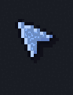

# Omarchy Pixel Cursors

Animated 8-bit cursors for [Omarchy](https://omarchy.org) that take their colors from your theme. Switch themes and the cursor rebuilds itself to match.

<p align="center"></p>

**[Try them in your browser](https://cursors.farzadhayat.dev/)**, no install needed. Pick any stock Omarchy theme, or load your own `colors.toml` to see your theme's cursors.


- 8-bit pixel art with a crisp outline, a top left bevel and a hard drop shadow.
- Three styles: your theme's accent color, or a light or dark body with accent animations.
- Animated hourglass for wait and a spinning pixel ring for progress.
- Drawn at every size Hyprland asks for, so pixels stay square at any display scale.
- Ships as both Hyprcursor and Xcursor, with every standard cursor name.

## Install

```bash
curl -fsSL https://cursors.farzadhayat.dev/install | bash
```

This installs `xorg-xcursorgen` if needed, downloads the repo to `~/.local/share/omarchy-pixel-cursors` and runs `install.sh`. Run it again to update. To do it by hand:

```bash
omarchy pkg add xorg-xcursorgen
git clone https://github.com/FarzadHayat/omarchy-pixel-cursors.git ~/.local/share/omarchy-pixel-cursors
~/.local/share/omarchy-pixel-cursors/install.sh
```

The installer:

- installs the theme to `~/.local/share/icons/Omarchy-Cursor` and makes it the active cursor,
- keeps it across restarts and Omarchy config resets with `~/.config/uwsm/env.d/50-omarchy-pixel-cursors`,
- makes it the default for apps that pick their own cursor,
- adds hooks that rebuild the cursor when you switch themes and re-apply it at login.

The hooks run the copy you installed from, so keep the folder where it is. If you move it, run `install.sh` again from the new place. If a rebuild fails you get a notification, and the details are in `~/.local/state/omarchy-cursor.log`.

## Style and size

Pass options to the installer and they stick, including through theme switches:

```bash
curl -fsSL https://cursors.farzadhayat.dev/install | bash -s -- --style light --size 36
```

- `--style accent` (default), `--style light` or `--style dark`.
- `--size` sets the cursor size, 24 by default. Pixel art only stays sharp at whole multiples of its 18 pixel grid, so at 100% display scaling the default cursor is fairly small. Try `--size 36` for a bigger one. At 150% and 200% scaling the default size already draws at 2x.
- `--body "#hex"` and `--rim "#hex"` pick your own colors.

## Uninstall

```bash
~/.local/share/omarchy-pixel-cursors/uninstall.sh
```

This removes the theme, hooks and settings and puts your previous cursor settings back.

## Testing

**[cursors.farzadhayat.dev](https://cursors.farzadhayat.dev/)** shows every cursor on your real pointer. Locally, run `./build.py --test-page` and open `test.html`: it also offers "Installed cursor", which shows the cursor actually installed on your system.

## Development

- `pixelart.py`: every cursor, drawn on a 17x17 pixel grid
- `build.py`: theme colors, rendering, Xcursor and Hyprcursor packaging
- `cursors.js`, `test.html`: the test page, which draws cursors in the browser
- `docs/`: the hosted site, rebuilt with `./build.py --site docs`
- `hooks/`: Omarchy `theme-set` and `post-boot` hooks
- `install.sh`, `uninstall.sh`, `web-install.sh` (served as the one line installer)
- `tests/check.py`: checks hotspots, a full build, and that the site's colors match; CI runs it on every push

```bash
./build.py --theme catppuccin --out /tmp/theme    # build without installing
./build.py --preview preview                      # contact sheet and GIFs
python3 tests/check.py
```

See [CHANGELOG.md](CHANGELOG.md) for releases.
