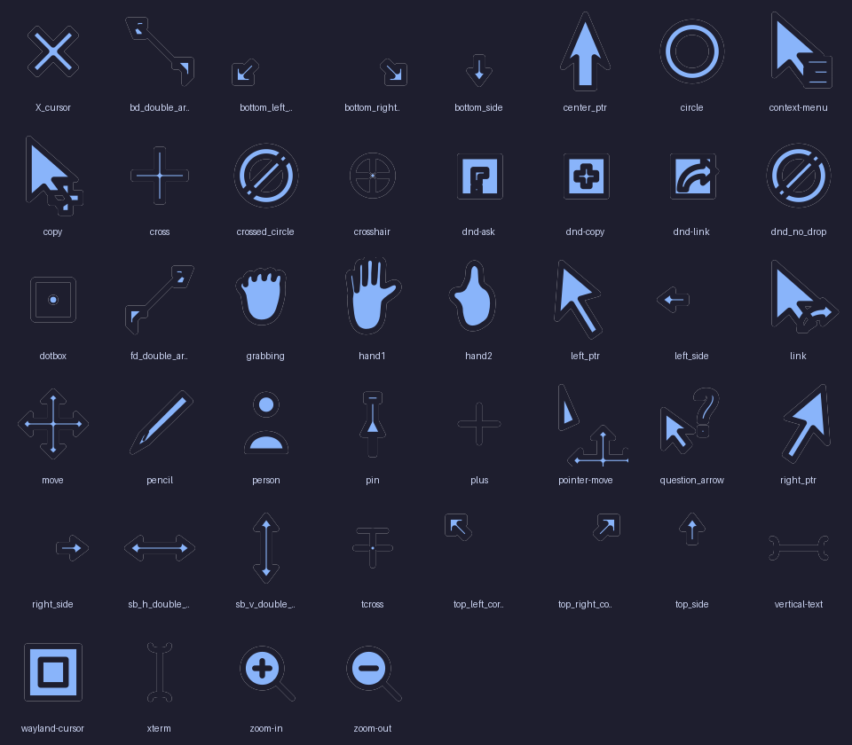

# Omarchy Cursor

Original cursor theme for Omarchy with custom SVG artwork, animated shapes, and theme-aware colorization.

## Features

- **Original SVG artwork**: Clean, geometric minimalist cursors with smooth organic curves.
- **Theme-Aware**: Integrates with Omarchy's `colors.toml` to automatically match your active theme.
- **Animations**: 54-frame fluid loading animations (wait spinner, progress ring).
- **Glow Effects**: Cursors have a subtle outer glow filter for improved visibility and a modern aesthetic.
- **Full Coverage**: 55 unique shapes with full X11 symlink aliases.
- **Hyprcursor Support**: Native Hyprcursor format generation alongside traditional Xcursor.

## Preview



### Animated Cursors
<p align="center">
  
  
</p>

## Installation

### Prerequisites

- Python 3.11+
- `cairosvg` (requires `libcairo2`, etc.)
- `xcursorgen`

```bash
# Ubuntu/Debian
sudo apt install libcairo2-dev x11-apps

# Arch Linux
sudo pacman -S cairo xorg-xcursorgen
```

### Quick Install

```bash
git clone https://github.com/FarzadHayat/omarchy-cursor.git
cd omarchy-cursor
./install.sh
```

### Theming

To build matching a specific omarchy theme:

```bash
./install.sh --theme tokyo-night
```

Or specify colors manually:

```bash
./install.sh --base "#f38ba8" --outline "#1e1e2e"
```

## Applying the Cursor

The script installs to `~/.local/share/icons/Omarchy-Cursor/`.
You can apply it in Hyprland with:

```bash
hyprctl setcursor Omarchy-Cursor 24
```

## Structure

- `src/omarchy_cursor/shapes/`: Programmatic SVG definitions in Python
- `config/cursors.toml`: Metadata mapping and hotspot coordinates
- `build.py`: Full rendering pipeline (SVG -> PNG -> Xcursor/Hyprcursor)
