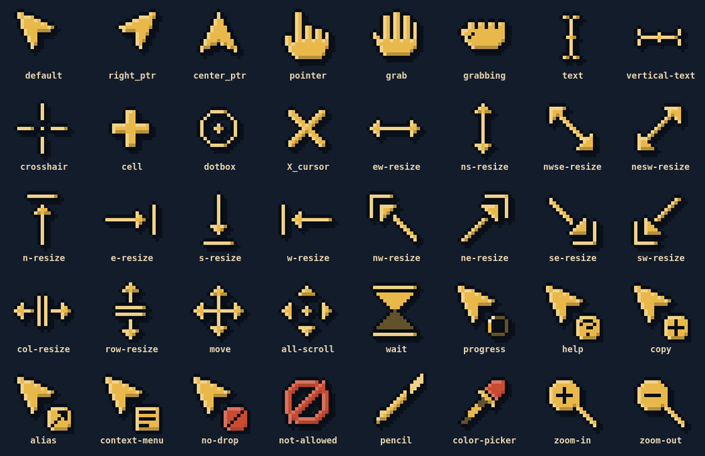

# Omarchy Cursor

Animated 8-bit cursors for [Omarchy](https://omarchy.org) that take their colors from your theme. Switch themes and the cursor rebuilds itself to match.

**[Try them in your browser](https://farzadhayat.github.io/omarchy-cursor/)**, no install needed. Pick any stock Omarchy theme, or load your own `colors.toml` to see your theme's cursors.



<p align="center">
  
  
</p>

- 8-bit pixel art with a crisp outline, a top left bevel and a hard drop shadow, filled with your theme's accent color.
- Animated hourglass for wait and a spinning pixel ring for progress.
- Rendered at whole number scales so pixels stay square, as both Hyprcursor and Xcursor, with the usual aliases.

## Install

Omarchy already ships `python3` and `hyprcursor`. You also need `xorg-xcursorgen`:

```bash
omarchy pkg add xorg-xcursorgen
git clone https://github.com/FarzadHayat/omarchy-cursor.git ~/.local/share/omarchy-cursor
~/.local/share/omarchy-cursor/install.sh
```

The installer:

- installs the theme to `~/.local/share/icons/Omarchy-Cursor` and makes it the active cursor,
- keeps it across restarts with `~/.config/hypr/cursor.lua` (or `cursor.conf` on older Omarchy releases),
- makes it the default for apps that pick their own cursor,
- adds a `theme-set` hook so the cursor rebuilds whenever you switch themes.

The hook runs the copy you installed from, so keep the cloned folder where it is. If you move it, run `install.sh` again from the new place.

## Uninstall

```bash
~/.local/share/omarchy-cursor/uninstall.sh
```

This removes the theme and hook and puts your previous cursor settings back.

## Options

```bash
./build.py --theme catppuccin --apply   # build for a specific theme
./build.py --body "#f38ba8" --apply     # pick your own colors
./build.py --preview preview            # contact sheet and GIFs
```

These last until your next theme switch. To keep an option, pass it to the installer instead, e.g. `./install.sh --body "#f38ba8"`.

## Testing

Open `test.html` in a browser and hover the tiles to see each cursor on your real pointer, over dark, light or busy backgrounds. Run `./build.py --test-page` first to enable the theme picker, which previews any Omarchy theme's cursors without switching your theme.

The hosted version in `docs/` is built with `./build.py --site docs` from the stock Omarchy themes and served by GitHub Pages.

## Layout

- `pixelart.py`: every cursor, drawn on a 17x17 pixel grid
- `build.py`: theme colors, rendering, Xcursor and Hyprcursor packaging
- `test.html`: cursor test area
- `docs/`: hosted copy of the test area
- `hooks/omarchy-cursor-sync`: Omarchy `theme-set` hook
- `install.sh`, `uninstall.sh`
